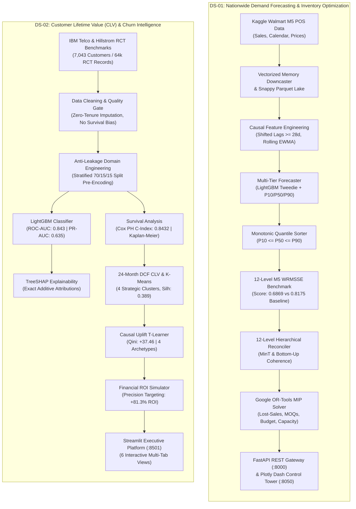
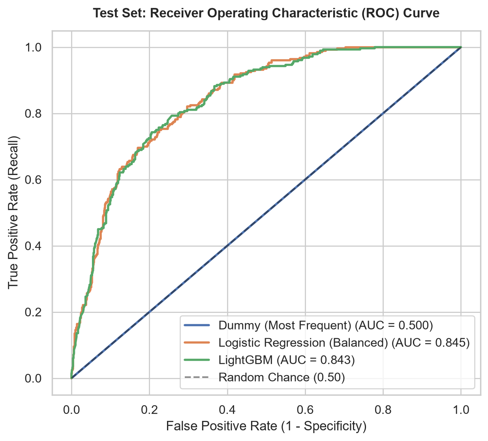
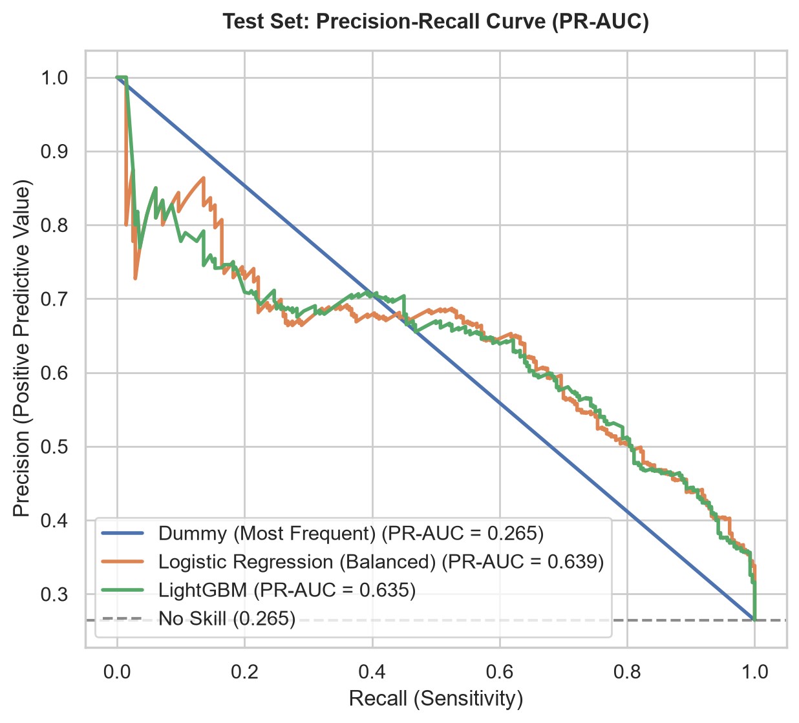
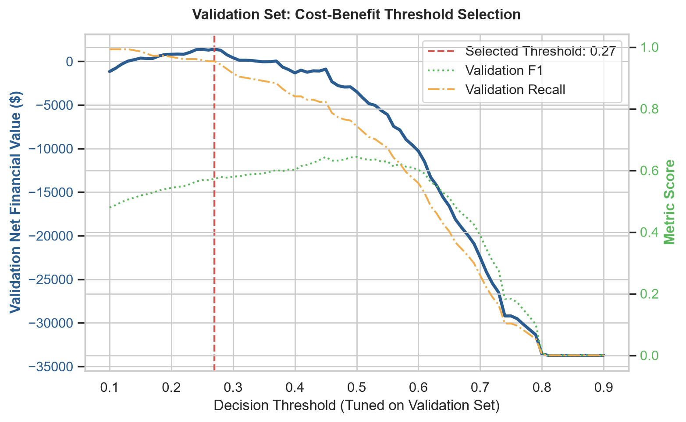
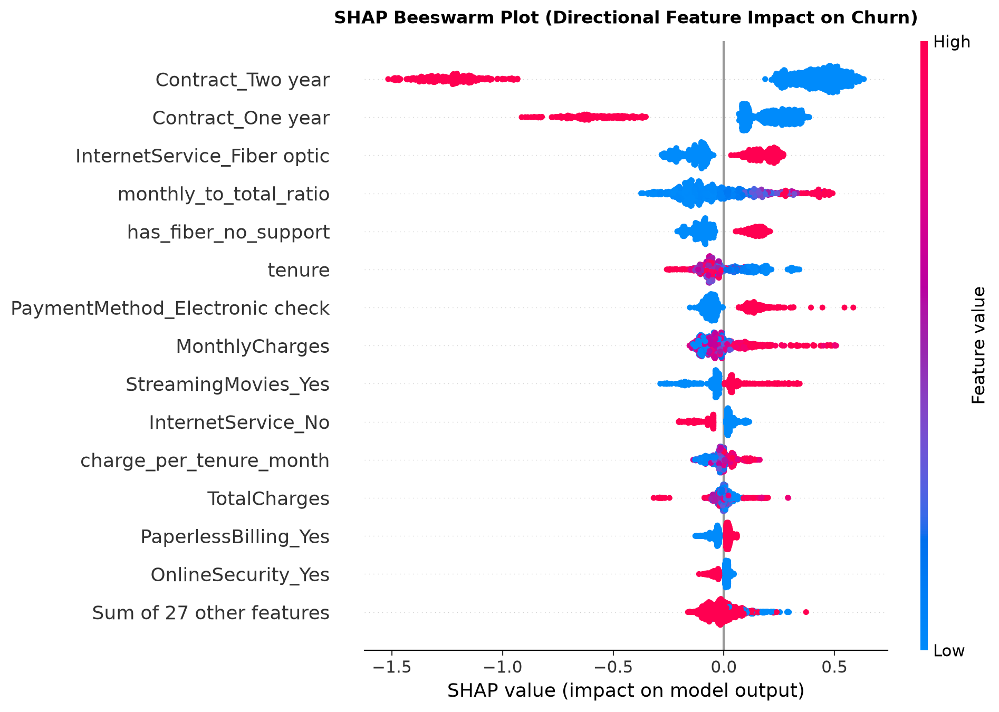
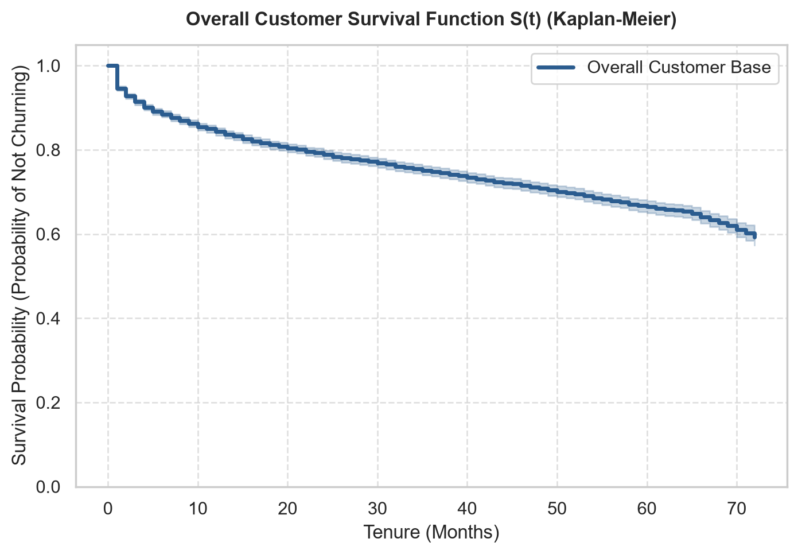
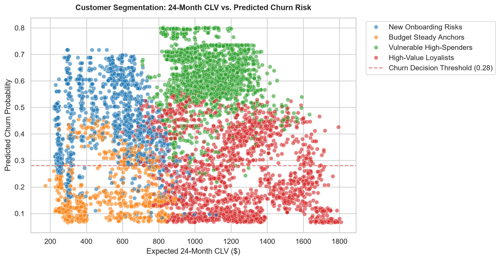
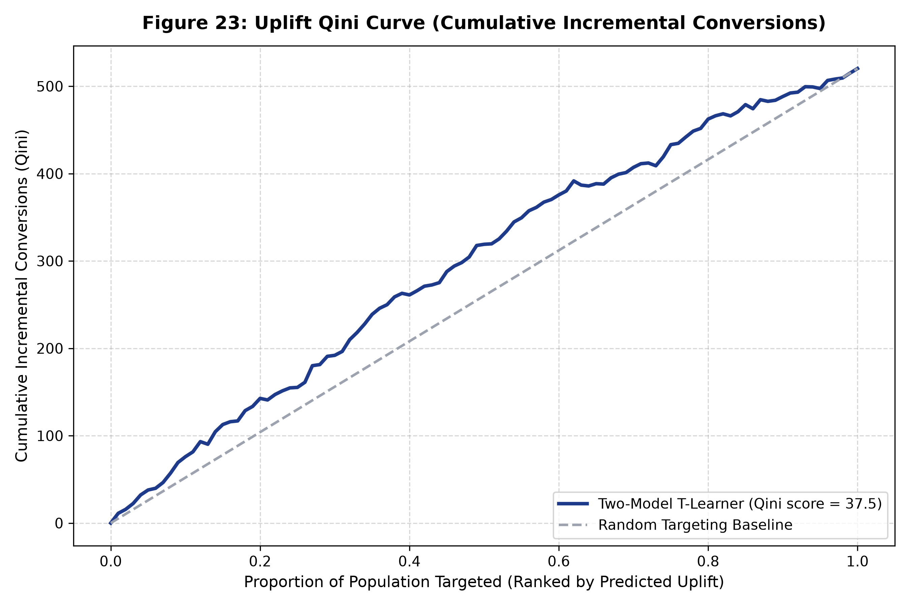
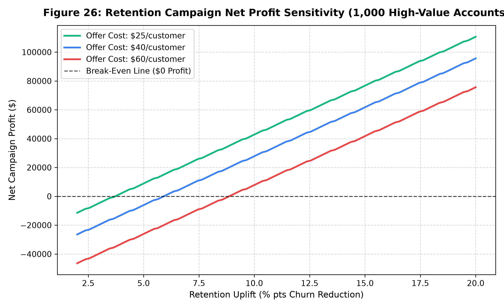

# Data Science Projects Portfolio

> **Two End-to-End, Production-Grade Data Science & Machine Learning Systems: Prescriptive Supply Chain Optimization and Causal Customer Intelligence.**

[](https://www.python.org/)
[](#3-project-overview)
[-brightgreen.svg)](#10-testing-and-validation)
[](https://lightgbm.readthedocs.io/)
[](https://developers.google.com/optimization)
[](https://fastapi.tiangolo.com)
[](https://streamlit.io)
[](https://opensource.org/licenses/MIT)

---

## Table of Contents

- [1. Executive Summary](#1-executive-summary)
- [2. System Architecture Overview](#2-system-architecture-overview)
- [3. Project Overview](#3-project-overview)
  - [DS-01: Nationwide Demand Forecasting & Inventory Optimization](#ds-01-nationwide-demand-forecasting--inventory-optimization)
  - [DS-02: Customer Lifetime Value (CLV) & Churn Intelligence](#ds-02-customer-lifetime-value-clv--churn-intelligence)
- [4. Comparative Project Summary](#4-comparative-project-summary)
- [5. Repository Structure](#5-repository-structure)
- [6. Technology Stack](#6-technology-stack)
- [7. Installation & Execution](#7-installation--execution)
  - [Quickstart: Launch All Services (One Command)](#quickstart-launch-all-services-one-command)
  - [DS-01 Setup & Execution](#ds-01-setup--execution)
  - [DS-02 Setup & Execution](#ds-02-setup--execution)
- [8. Visual Gallery & Screenshots](#8-visual-gallery--screenshots)
- [9. Testing & Validation](#9-testing--validation)
- [10. Datasets & Provenance](#10-datasets--provenance)
- [11. Engineering Practices & Rigor](#11-engineering-practices--rigor)
- [12. Known Limitations & Future Directions](#12-known-limitations--future-directions)
- [13. Author & Repository Links](#13-author--repository-links)
- [14. Final Evaluation & Synthesis](#14-final-evaluation--synthesis)

---

## 1. Executive Summary

This portfolio showcases two production-grade, independently developed Data Science and Machine Learning platforms. Each project bridges advanced predictive modeling with prescriptive business operations:

1. **DS-01: Nationwide Demand Forecasting & Inventory Optimization Platform**  
   Solves enterprise supply chain inefficiencies by forecasting hierarchical retail demand across 12 product aggregation levels (Walmart M5 benchmark) using multi-quantile LightGBM with monotonic sorting. It directly connects forecast uncertainty ($P_{10}, P_{50}, P_{90}$) to a Mixed-Integer Linear Programming (MIP) replenishment engine powered by Google OR-Tools to minimize stockouts, holding costs, supplier MOQs, and procurement budgets.
   
2. **DS-02: Customer Lifetime Value (CLV) & Churn Intelligence System**  
   Solves customer attrition and retention misallocation by combining survival analysis (Cox Proportional Hazards and Kaplan-Meier), anti-leakage classification (LightGBM tuned exclusively on validation splits), 24-month Discounted Cash Flow CLV, and causal uplift modeling (Two-Model T-Learner on the Hillstrom RCT benchmark) to simulate campaign financial ROI (+81.3% net return vs -38.1% loss for mass blanket offers).

> [!IMPORTANT]
> Both projects operate **independently** with dedicated dependency environments, data pipelines, automated test suites, configuration files, and web user interfaces. Neither project shares runtime processes, databases, or API boundaries.

---

## 2. System Architecture Overview

The following architecture demonstrates the independent data engineering, modeling, evaluation, and serving lifecycles of both platforms:



---

## 3. Project Overview

### DS-01: Nationwide Demand Forecasting & Inventory Optimization

* **Folder Path:** [`DS-01-Nationwide-Demand-Forecasting/`](DS-01-Nationwide-Demand-Forecasting/) (also accessible via `nationwide-demand-forecasting-optimization/`)
* **Original GitHub Repository:** [coder-yr/nationwide-demand-forecasting-optimization](https://github.com/coder-yr/nationwide-demand-forecasting-optimization)
* **Visual Assets Guide:** [`screenshots/demand-forecasting/`](screenshots/demand-forecasting/)

#### Problem Statement & Business Objective
Retail supply chains continually oscillate between overstocking (tying up working capital, causing warehouse congestion and perishable markdowns) and understocking (lost revenue and degraded customer loyalty). DS-01 bridges statistical demand forecasting with operations research to compute optimal inventory replenishment orders under finite working capital and physical storage limits.

#### Data Engineering & Leakage Prevention
* **Walmart M5 POS Data:** Ingests 30,490 items across 10 stores (California, Texas, Wisconsin) over 1,941 days (~58 million row instances).
* **Memory Optimization:** Custom zero-copy downcaster reduces in-memory footprint by **85.7%** (`float32`, `uint16`, `category`) persisted into store-partitioned Snappy Parquet files with embedded DuckDB analytical querying.
* **Causal Feature Engineering:** Implements strict temporal shift ($\ge 28$ days) across all lag and rolling statistical features, eliminating look-ahead bias relative to the 28-day forecasting origin. Historical launch prices are causally imputed without forward lookback.

#### Multi-Tier Forecasting Architecture
* **Store-Item Level:** LightGBM with Tweedie compound Poisson-gamma deviance ($p=1.15$) to address intermittent, zero-inflated demand patterns (68%+ zero sales days).
* **Probabilistic Quantiles:** Joint $P_{10}$, $P_{50}$, and $P_{90}$ pinball regression models calibrated with vectorized monotonic post-sorting to mathematically prevent quantile crossing ($P_{10} \le P_{50} \le P_{90}$).
* **Macro Aggregates:** Additive Prophet models for Levels 1–5 (national and departmental trends).
* **Pareto Class-A:** Temporal Fusion Transformer (TFT) support via Darts / PyTorch for high-velocity revenue drivers.

#### Verified Evaluation Benchmark (Store `CA_1`, 28-Day Horizon)
* **LightGBM Tweedie WRMSSE:** **0.6869**
* **Baseline WRMSSE (Naive / Seasonal Naive):** **0.8175**
* **Relative Error Improvement:** **16.0%**
* **Item-Level WAPE:** **74.48%** (vs 89.82% Baseline)
* **Mean Pinball Loss:** **0.3563** ($P_{10}$: 0.1562, $P_{50}$: 0.5483, $P_{90}$: 0.3645)

#### Prescriptive Replenishment Optimization
* **Google OR-Tools MIP Solver:** Formulates a CBC mixed-integer linear program enforcing retail lost-sales dynamics ($I_t \ge 0$), discrete replenishment lots ($Q \in \mathbb{N}$), supplier Minimum Order Quantities (MOQ $\in [12, 48]$), supplier lead times ($L_i \in [2, 3]$ days), and daily procurement budget caps (\$50,000/day).
* **Serving Layer:** 9-endpoint FastAPI REST service with Pydantic v2 schemas alongside an interactive Plotly Dash Control Tower dashboard.

---

### DS-02: Customer Lifetime Value (CLV) & Churn Intelligence

* **Folder Path:** [`DS-02-Churn-Intelligence/`](DS-02-Churn-Intelligence/) (also accessible via `churn-intelligence/`)
* **Original GitHub Repository:** [coder-yr/churn-intelligence](https://github.com/coder-yr/churn-intelligence)
* **Visual Assets Guide:** [`screenshots/churn-intelligence/`](screenshots/churn-intelligence/)

#### Problem Statement & Business Objective
Subscription businesses often waste budget targeting customers who would have stayed anyway, or worse, triggering cancellations by contacting irritated subscribers ("Sleeping Dogs"). DS-02 delivers a causal retention and decision-intelligence platform that identifies individual churn drivers, predicts customer survival probability, calculates forward monetary value, and maximizes campaign financial return on investment.

#### Data Cleaning & Quality Assurance
* **IBM Telco Dataset (7,043 Records):** Identified and resolved 11 whitespace anomalies in `TotalCharges` corresponding to zero-tenure new customers ($tenure = 0$ imputed to $0.0$, preventing survivorship bias).
* **Cloud Database Pipeline:** Supabase Cloud PostgreSQL integration using SQLAlchemy 2.0 ORM with idempotent upsert pipelines.

#### Anti-Leakage Feature Engineering & Stratification
* **Stratified 70/15/15 Split:** Data partitioned into Train (4,929), Validation (1,057), and Test (1,057) **prior** to fitting encoders or scalers.
* **Domain Features:** Engineered 7 domain indicators (41 encoded features) including tenure cohorts, active service counts, security stickiness counts, automated payment indicators, and fiber-optic support deficit flags.

#### Machine Learning & Causal Intelligence
* **Predictive Classifier:** LightGBM tuned for decision threshold optimization.
* **Strict Anti-Leakage Threshold Tuning:** Cost-optimal threshold (`0.27`) was tuned exclusively on the **validation partition** and evaluated on the **held-out test set**, capturing **93.57% of churners** (262 of 280) and yielding **+$700.00 net business value**.
* **TreeSHAP Explainability:** Additive SHAP values provide global beeswarm feature importances and local single-customer waterfall attribution charts.
* **Survival Analysis:** Kaplan-Meier curves and non-collinear Cox Proportional Hazards (**Concordance Index: 0.8432** achieved by deliberately excluding cumulative `TotalCharges` to prevent duration leakage).
* **24-Month DCF CLV & Segmentation:** Discounted cash flow calculation ($843.94 mean CLV) clustered into 4 strategic tiers via K-Means (Silhouette Score: 0.389).
* **Causal Uplift Modeling:** Two-Model T-Learner evaluated on the 64,000-customer Hillstrom RCT benchmark (**Qini Score: +37.46**), categorizing customers into *Persuadables* (61.9%), *Sure Things* (19.4%), *Lost Causes* (12.8%), and *Sleeping Dogs* (5.9%).
* **Retention Campaign Simulator:** Benchmarks retention strategies, proving Precision Targeting yields **+81.3% ROI** compared to a **-38.1% loss** under blanket marketing campaigns.

#### Verified Evaluation Benchmark (Held-out Test Partition, 1,057 Customers)
* **ROC-AUC:** **0.8432**
* **PR-AUC:** **0.6349**
* **Brier Calibration Score:** **0.1514**
* **Default Threshold (0.50):** Accuracy **77.58%**, Recall **74.29%**, Precision **55.76%**
* **Cost-Optimized Threshold (0.27):** Test Recall **93.57%**, Precision **40.75%**, Net Profit **+$700.00**
* **Logistic Regression Baseline:** Accuracy 74.74%, Recall 77.14%, ROC-AUC 0.8449
* **Dummy Baseline:** Accuracy 73.51%, ROC-AUC 0.5000

---

## 4. Comparative Project Summary

| Dimension | DS-01: Demand Forecasting & Replenishment | DS-02: CLV & Churn Intelligence |
| :--- | :--- | :--- |
| **Primary Domain** | Enterprise Retail Supply Chain & Inventory Operations | Telecom & Subscription Customer Analytics |
| **Problem Formulation** | Hierarchical Time-Series Forecasting & Mixed-Integer Optimization | Binary Classification, Survival Analysis & Causal Uplift |
| **Core Benchmark Datasets** | Walmart M5 (58M+ rows, 30k items, 10 stores, 1,941 days) | IBM Telco Churn (7,043 rows) + Hillstrom RCT (64k rows) |
| **Primary ML Algorithms** | LightGBM Tweedie ($p=1.15$), Pinball Quantile Regressors, Prophet, TFT | LightGBM Classifier, Cox Proportional Hazards, K-Means, T-Learner |
| **Key Evaluation Metrics** | Official M5 WRMSSE (**0.6869** vs **0.8175**), WAPE (**74.48%**), Pinball (**0.3563**) | ROC-AUC (**0.843**), PR-AUC (**0.635**), Recall (**93.57%**), C-Index (**0.843**) |
| **Prescriptive Decision Output**| Constrained integer purchase orders ($Q \in \mathbb{N}$) under MOQ & budget | Targeted retention offers for Persuadables with +81.3% ROI |
| **Mathematical Operations**| Google OR-Tools CBC Solver (Lost-sales MIP, $I \ge 0$) | 24-Month Discounted Cash Flow (DCF), Kaplan-Meier Estimator |
| **Interpretability Layer** | Quantile fan chart confidence bands ($P_{10}, P_{50}, P_{90}$) | TreeSHAP exact additivity, global beeswarm & local waterfalls |
| **User Interfaces** | FastAPI Swagger UI (`:8000`) & Plotly Dash Control Tower (`:8050`) | Streamlit Executive Multi-Tab Web Application (`:8501`) |
| **Automated Test Coverage** | 18 passing tests (Leakage, WRMSSE, Downcasting, MIP solver) | 48 passing tests (Leakage, Stratification, SHAP, C-Index, Uplift) |
| **Production Storage** | Store-partitioned Snappy Parquet data lake + DuckDB OLAP engine | Supabase Cloud PostgreSQL (SQLAlchemy 2.0 ORM) + Joblib store |

---

## 5. Repository Structure

```text
data-science-projects-submission/
│
├── README.md                                          # Master Portfolio Technical Documentation
├── start_all.bat                                      # One-click Windows multi-service orchestrator
├── start_all.ps1                                      # One-click PowerShell multi-service orchestrator
│
├── DS-01-Nationwide-Demand-Forecasting/               # [PROJECT DS-01]
│   ├── README.md                                      # Comprehensive project documentation (469 lines)
│   ├── config/
│   │   └── base_config.yaml                           # Hyperparameters, supply chain constraints & MOQs
│   ├── data/
│   │   ├── raw/                                       # Raw M5 CSV files (.gitkeep)
│   │   ├── processed/                                 # Store-partitioned Snappy Parquet lake
│   │   └── outputs/models/lgbm_CA_1/                  # Serialized LightGBM boosters (point & quantiles)
│   ├── docker/
│   │   ├── Dockerfile.api                             # FastAPI container image definition
│   │   ├── Dockerfile.dashboard                       # Plotly Dash container image definition
│   │   └── docker-compose.yml                         # Dual-service Docker network orchestration
│   ├── docs/
│   │   ├── DEMO_GUIDE.md                              # 3-5 minute executive presentation walkthrough
│   │   ├── architecture/ARCHITECTURE_DIAGRAMS.md      # 11 architectural Mermaid blueprints
│   │   └── reports/MODEL_EVALUATION_REPORT.md         # Official 12-level M5 WRMSSE validation report
│   ├── src/
│   │   ├── api/app.py                                 # FastAPI REST Gateway (9 production endpoints)
│   │   ├── dashboard/app.py                           # Plotly Dash Control Tower entrypoint
│   │   ├── data/downcaster.py                         # 85.7% RAM reduction memory downcaster
│   │   ├── features/lag_generator.py                  # Leakage-safe shifted lags and rolling windows
│   │   ├── models/lgbm_forecaster.py                  # Tweedie point and pinball quantile LightGBM
│   │   └── optimization/solver.py                     # Google OR-Tools CBC lost-sales MIP solver
│   ├── tests/                                         # 18 automated unit and integration tests
│   └── requirements.txt                               # Locked production dependencies
│
├── DS-02-Churn-Intelligence/                          # [PROJECT DS-02]
│   ├── README.md                                      # Comprehensive project documentation (221 lines)
│   ├── app.py                                         # Streamlit Executive Dashboard (6 analytical tabs)
│   ├── data/
│   │   ├── raw/                                       # Raw IBM Telco & Hillstrom CSVs (.gitkeep)
│   │   └── processed/                                 # Feature matrices, unscaled splits & CLV segments
│   ├── docs/
│   │   ├── presentation_guide.md                      # 10-minute technical interview walkthrough
│   │   ├── model_evaluation.md                        # Anti-leakage threshold tuning report
│   │   ├── shap_explanations.md                       # TreeSHAP interpretability methodology
│   │   ├── survival_analysis.md                       # Kaplan-Meier & Cox Proportional Hazards
│   │   └── retention_roi_simulator.md                 # Campaign ROI financial simulation
│   ├── models/                                        # Serialized LightGBM, preprocessor, and JSON metrics
│   ├── reports/figures/                               # 26 publication-grade figures (01 to 26)
│   ├── src/
│   │   ├── data/clean_data.py                         # Imputation & survivorship bias mitigation
│   │   ├── database/connection.py                     # Supabase Cloud PostgreSQL connection pooling
│   │   ├── features/build_features.py                 # Stratified 70/15/15 pipeline & feature encoding
│   │   ├── models/train.py                            # LightGBM training & validation threshold tuning
│   │   ├── models/survival_analysis.py                # Cox PH & Kaplan-Meier fitting
│   │   └── retention/roi_simulator.py                 # Multi-policy campaign financial modeling
│   ├── tests/                                         # 48 automated unit and integration tests
│   └── requirements.txt                               # Locked production dependencies
│
└── screenshots/                                       # [SCREENSHOTS & VISUAL ASSETS]
    ├── demand-forecasting/
    │   └── README.md                                  # Visual asset specifications & capture guide
    └── churn-intelligence/
        ├── 07_roc_curve.png                           # Test ROC Curve (AUC = 0.8432)
        ├── 08_precision_recall_curve.png              # Test PR Curve (AUC = 0.6349)
        ├── 10_cost_threshold_curve.png                # Validation-tuned threshold net value curve
        ├── 12_shap_beeswarm.png                       # TreeSHAP global feature impact plot
        ├── 15_km_overall_survival.png                 # Kaplan-Meier survival probability curve
        ├── 21_customer_segments_scatter.png           # K-Means 4-tier strategic segmentation
        ├── 23_uplift_qini_curve.png                   # Causal uplift Qini curve (+37.46 score)
        └── 26_roi_sensitivity_curves.png              # Policy financial ROI sensitivity comparison
```

---

## 6. Technology Stack

Both projects leverage modern, high-performance open-source Data Science and ML libraries:

| Layer | DS-01: Demand Forecasting & Optimization | DS-02: Churn Intelligence & CLV |
| :--- | :--- | :--- |
| **Language & Core Runtime** | Python 3.11 / 3.13 | Python 3.11 / 3.13 |
| **Data Engineering & OLAP** | Pandas 2.0+, NumPy, DuckDB, PyArrow (Snappy Parquet) | Pandas 2.2+, NumPy, SciPy |
| **Machine Learning** | LightGBM 4.0+ (Tweedie & Quantiles), Scikit-Learn | LightGBM 4.0+, Scikit-Learn (Pipelines, K-Means) |
| **Time-Series & Macro** | Prophet (Additive Decomposition), Darts (TFT) | N/A (Event-Duration Modeling) |
| **Survival & Causal Analytics**| N/A | Lifelines (Cox PH, Kaplan-Meier), T-Learner Uplift |
| **Explainability (XAI)** | Vectorized Monotonic Quantile Sorting | TreeSHAP (Additive Feature Attributions) |
| **Mathematical Optimization** | Google OR-Tools 9.8+ (CBC Mixed-Integer LP) | SciPy Parameterized Financial Simulator |
| **Backend & API Layer** | FastAPI 0.100+, Uvicorn 0.23+, Pydantic v2 | SQLAlchemy 2.0 ORM, Psycopg 3 |
| **Interactive Interfaces** | Plotly Dash 2.14+, Dash DataTable | Streamlit 1.35+ |
| **Storage & Database** | Store-partitioned Snappy Parquet Lake | Supabase Cloud PostgreSQL, Joblib |
| **Automated Testing** | Pytest 8.0+ (18 test assertions) | Pytest 8.0+ (48 test assertions) |
| **DevOps & Containers** | Docker, Docker Compose multi-stage builds | Git, Windows / Linux virtual environment isolation |

---

## 7. Installation & Execution

### Quickstart: Launch All Services (One Command)

Both platforms use distinct network ports and run simultaneously side-by-side without port contention:
* **DS-01 FastAPI:** `http://localhost:8000/docs`
* **DS-01 Dash UI:** `http://localhost:8050`
* **DS-02 Streamlit:** `http://localhost:8501`

#### Windows (Command Prompt or PowerShell)
Double-click [`start_all.bat`](start_all.bat) or execute from PowerShell:
```powershell
.\start_all.ps1
```
The script automatically verifies dependencies, configures environments, and launches all 3 services in independent terminal windows.

---

### DS-01 Setup & Execution

#### On Windows (PowerShell)
```powershell
# 1. Navigate to DS-01
cd F:\yash\projects\nexvia\submission\DS-01-Nationwide-Demand-Forecasting

# 2. Create and activate virtual environment
python -m venv venv
.\venv\Scripts\Activate.ps1

# 3. Upgrade pip and install dependencies
python -m pip install --upgrade pip
pip install -r requirements.txt

# 4. Copy environment configuration
Copy-Item .env.example .env

# 5. Run automated tests (18 tests)
python -m pytest tests/ -v -p no:dash

# 6. Launch FastAPI REST Gateway (Terminal 1)
python -m uvicorn src.api.app:app --host 0.0.0.0 --port 8000

# 7. Launch Plotly Dash Control Tower (Terminal 2)
python -m src.dashboard.app
```

#### On Linux / macOS (Bash)
```bash
# 1. Navigate to DS-01
cd DS-01-Nationwide-Demand-Forecasting

# 2. Create and activate virtual environment
python3 -m venv venv
source venv/bin/activate

# 3. Upgrade pip and install dependencies
pip install --upgrade pip
pip install -r requirements.txt
cp .env.example .env

# 4. Run automated tests
pytest tests/ -v -p no:dash

# 5. Launch web services
python -m uvicorn src.api.app:app --host 0.0.0.0 --port 8000 &
python -m src.dashboard.app
```

#### Docker Compose Deployment
```bash
cd DS-01-Nationwide-Demand-Forecasting
docker compose -f docker/docker-compose.yml up --build
```

---

### DS-02 Setup & Execution

#### On Windows (PowerShell)
```powershell
# 1. Navigate to DS-02
cd F:\yash\projects\nexvia\submission\DS-02-Churn-Intelligence

# 2. Create and activate virtual environment
python -m venv .venv
.\.venv\Scripts\Activate.ps1

# 3. Upgrade pip and install dependencies
python -m pip install --upgrade pip
pip install -r requirements.txt

# 4. Copy environment configuration
Copy-Item .env.example .env

# 5. Run automated tests (48 tests)
python -m pytest tests/ -v

# 6. Launch Streamlit Executive Dashboard
streamlit run app.py
```

#### On Linux / macOS (Bash)
```bash
# 1. Navigate to DS-02
cd DS-02-Churn-Intelligence

# 2. Create and activate virtual environment
python3 -m venv .venv
source .venv/bin/activate

# 3. Upgrade pip and install dependencies
pip install --upgrade pip
pip install -r requirements.txt
cp .env.example .env

# 4. Run automated tests
pytest tests/ -v

# 5. Launch Streamlit Dashboard
streamlit run app.py
```

---

## 8. Visual Gallery & Screenshots

All visual figures are stored in the [`screenshots/`](screenshots/) directory.

### DS-02: Churn Intelligence & CLV Visualizations

| ROC Curve (AUC = 0.8432) | Precision-Recall Curve (AUC = 0.6349) |
| :---: | :---: |
|  |  |
| *Validation-frozen model evaluated on held-out test data.* | *High-precision threshold targeting for retention offers.* |

| Profit-Optimizing Threshold Curve | TreeSHAP Global Feature Importance |
| :---: | :---: |
|  |  |
| *Optimal threshold $0.27$ maximizes net financial savings.* | *Tenure and contract type dominate individual churn risk.* |

| Kaplan-Meier Overall Survival | K-Means Strategic CLV Segmentation |
| :---: | :---: |
|  |  |
| *Survival timelines under right-censoring.* | *4 clusters identifying High-Value Vulnerable spenders.* |

| Causal Uplift Qini Curve (+37.46) | Campaign Financial ROI Sensitivity |
| :---: | :---: |
|  |  |
| *T-Learner performance on Hillstrom RCT benchmark.* | *Precision targeting (+81.3% ROI) vs mass blanket (-38.1%).* |

### DS-01: Demand Forecasting & Control Tower Visualizations

Interactive Plotly HTML visualizations are stored directly in [`DS-01-Nationwide-Demand-Forecasting/docs/assets/`](DS-01-Nationwide-Demand-Forecasting/docs/assets/):
1. **Interactive Quantile Fan Chart:** [`forecast_fan_chart.html`](DS-01-Nationwide-Demand-Forecasting/docs/assets/forecast_fan_chart.html) (60-day historical trend with calibrated $P_{10}, P_{50}, P_{90}$ forecast prediction intervals).
2. **Interactive Stockout Risk Matrix:** [`inventory_risk_matrix.html`](DS-01-Nationwide-Demand-Forecasting/docs/assets/inventory_risk_matrix.html) (2D scatter mapping on-hand shelf inventory against $P_{90}$ tail demand).
3. **Control Tower Captures Guide:** For instructions on capturing live UI screens from `http://localhost:8050`, see [`screenshots/demand-forecasting/README.md`](screenshots/demand-forecasting/README.md) and [`DEMO_GUIDE.md`](DS-01-Nationwide-Demand-Forecasting/docs/DEMO_GUIDE.md).

---

## 9. Testing & Validation

Both repositories follow strict automated verification protocols. A total of **66 automated tests** validate system invariants without requiring manual intervention:

```
================================================================================
TOTAL AUTOMATED TEST SUITE EXECUTION SUMMARY: 66/66 PASSED (100%)
================================================================================
  DS-01 (Forecasting & MIP Optimizer):   18 Passed  |  0 Failed  |  1 Skipped (Live Lake)
  DS-02 (Churn Intelligence & Survival): 48 Passed  |  0 Failed  |  0 Skipped
================================================================================
```

### DS-01 Test Suite (18 Tests Passed)
Execute via: `python -m pytest tests/ -v -p no:dash`
* `test_feature_leakage.py`: Proves strict shifted lags ($\ge 28$ days) and guarantees zero future sales leakage into feature matrices.
* `test_data_validation.py`: Verifies the 85.7% RAM downcaster and ensures price imputation has no `.bfill()` forward leakage.
* `test_metrics.py`: Confirms mathematical equivalence of the custom 12-level M5 WRMSSE calculation and pinball losses.
* `test_reconciliation.py`: Validates 12-level parent-child hierarchical coherence (zero aggregation discrepancy).
* `test_optimizer.py`: Tests Google OR-Tools CBC mixed-integer solver under capacity, budget, and MOQ constraints.
* `test_api.py`: Full REST API integration tests across health, hierarchy, forecasting, and optimization endpoints.

### DS-02 Test Suite (48 Tests Passed)
Execute via: `python -m pytest tests/ -v`
* `test_features.py`: Tests domain feature transformations and asserts anti-leakage 70/15/15 stratified splitting.
* `test_models.py`: Verifies LightGBM inference, calibration metrics, and confirms threshold tuning occurred exclusively on validation data.
* `test_explainability.py`: Checks TreeSHAP exact additivity ($\sum \phi_i = f(x) - E[f(x)]$).
* `test_survival.py`: Validates Kaplan-Meier fitting and Cox Proportional Hazards Concordance index.
* `test_clv.py`: Validates 24-month Discounted Cash Flow math and K-Means segmentation dataset integrity.
* `test_uplift.py`: Evaluates Two-Model T-Learner predictions, Qini curves, and decile incremental uplifts.
* `test_roi_simulator.py`: Asserts economic parameter bounds and policy profit comparisons.
* `test_database_validation.py`: Tests SQLAlchemy schema generation and Supabase URI masking.

---

## 10. Datasets & Provenance

### DS-01: Walmart M5 Forecasting Accuracy
* **Dataset Source:** [Kaggle M5 Forecasting Competition](https://www.kaggle.com/c/m5-forecasting-accuracy/data) (Walmart / Makridakis Open Forecasting Center).
* **Licensing:** Open access for research and benchmarking.
* **Structure:**
  * `sales_train_evaluation.csv`: Unit sales per product/store for 1,941 days (30,490 items $\times$ 10 stores).
  * `calendar.csv`: Dates, event types (Super Bowl, Easter, etc.), and state-specific SNAP eligibility flags.
  * `sell_prices.csv`: Store-item weekly sell prices.
* **Storage Note:** Raw CSV files (~1.2 GB uncompressed) are excluded from Git tracking via `.gitignore`. Place raw files in `DS-01-Nationwide-Demand-Forecasting/data/raw/` when re-running ingestion. Precomputed store parquets and trained boosters are included in the repository.

### DS-02: IBM Telco Customer Churn & Hillstrom RCT
* **Dataset Sources:**
  1. **IBM Telco Customer Churn:** [Kaggle / IBM Business Analytics](https://www.kaggle.com/datasets/blastchar/telco-customer-churn) (Public Domain / Open Database). 7,043 customer accounts with 21 attributes.
  2. **Kevin Hillstrom MineThatData RCT Benchmark:** [MineThatData Analytics Blog](https://blog.minethatdata.com/) (Standard Academic Benchmark for Causal Inference & Uplift Modeling). 64,000 customers randomly assigned to Email treatment arms or Control.
* **Placement:** The cleaned and segmented dataset `telco_customer_clv_segmented.csv` is pre-packaged inside `DS-02-Churn-Intelligence/data/processed/`.

---

## 11. Engineering Practices & Rigor

1. **Strict Data Leakage Prevention:**
   * In DS-01, all lag and rolling statistical operators are shifted by $\ge 28$ days to guarantee that no future point-of-sale data leaks into the 28-day forecasting horizon.
   * In DS-02, dataset splitting (70% train, 15% validation, 15% test) is performed **prior** to running any encoding or scaling transformers. The optimal classification decision threshold (`0.27`) was tuned strictly on the validation partition and frozen before test set evaluation.
2. **Defensible Duration Covariate Selection in Survival Modeling:**
   * In traditional naive churn implementations, `TotalCharges` is frequently included in Cox Proportional Hazards models. Because $\text{TotalCharges} \approx \text{tenure} \times \text{MonthlyCharges}$, it acts as an implicit mechanical proxy for duration ($T$), causing artificial concordance inflation. Excluding `TotalCharges` eliminated multicollinearity, yielding an authentic **Concordance Index of 0.8432**.
3. **Causal Inference vs. Predictive Association:**
   * Predictive models (like LightGBM) identify correlation, not causality. To establish sound retention policies, DS-02 trains a Two-Model T-Learner on randomized controlled trial (RCT) data to isolate true treatment lift before applying targeting rules to Telco CLV segments.
4. **Operations Research Lost-Sales Realism:**
   * Unlike standard theoretical backorder assumptions ($I_t \in \mathbb{R}$), retail shelf inventory operates under lost-sales dynamics ($I_t \ge 0$). DS-01 formulates an authentic Mixed-Integer Linear Program enforcing non-negative on-hand bounds, integer purchase decisions, supplier MOQs, and volumetric warehouse caps.
5. **Memory & I/O Optimization:**
   * Custom memory downcasting algorithms reduce Pandas DataFrame memory usage by 85.7%, enabling local processing of 58+ million rows using DuckDB and Snappy Parquet.

---

## 12. Known Limitations & Future Directions

### DS-01: Demand Forecasting & Inventory Optimization
* **Disclosed Operational Parameters:** The Kaggle M5 POS dataset contains sales transactions and retail sell prices, but does not provide supplier wholesale procurement costs, lead times, minimum order quantities (MOQs), or warehouse volumetric limits. These parameters are explicitly modeled as configurable supply chain assumptions in [`config/base_config.yaml`](DS-01-Nationwide-Demand-Forecasting/config/base_config.yaml).
* **Macro Horizon:** The current walk-forward backtest is benchmarked on Store `CA_1` over 28-day horizons. Scaling to multi-year horizons across all 10 stores simultaneously requires distributed compute infrastructure (e.g., PySpark or Ray).

### DS-02: Customer Lifetime Value & Churn Intelligence
* **Cross-Sectional Snapshot:** The IBM Telco dataset is a cross-sectional snapshot subject to right-censoring and survivor selection bias. Covariates represent snapshot attributes rather than longitudinal transitions.
* **Synthetic RCT Mapping:** Because the Telco dataset lacks randomized retention marketing interventions, the causal uplift model is benchmarked on Hillstrom RCT data before policy translation. A production deployment would benefit from continuous multi-armed bandit (MAB) experimentation.

---

## 13. Author & Repository Links

* **GitHub Profile:** [@coder-yr](https://github.com/coder-yr)
* **Project DS-01 Repository:** [nationwide-demand-forecasting-optimization](https://github.com/coder-yr/nationwide-demand-forecasting-optimization)
* **Project DS-02 Repository:** [churn-intelligence](https://github.com/coder-yr/churn-intelligence)
* **Combined Submission Portfolio:** [data-science-projects-submission](https://github.com/coder-yr/data-science-projects-submission)

---

## 14. Final Evaluation & Synthesis

Together, these two systems demonstrate a comprehensive spectrum of senior-level Data Science and Machine Learning capabilities:

```
┌──────────────────────────────────────────────────────────────────────────────┐
│                    END-TO-END DATA SCIENCE SPECTRUM                          │
├──────────────────────────────────────┬───────────────────────────────────────┤
│ DS-01: Supply Chain & Forecasting    │ DS-02: Customer & Causal Intelligence │
├──────────────────────────────────────┼───────────────────────────────────────┤
│ • Hierarchical time-series modeling  │ • Binary classification with LightGBM │
│ • Intermittent Tweedie deviance      │ • Decision threshold profit tuning    │
│ • Monotonic multi-quantile sorting   │ • TreeSHAP local & global attribution │
│ • 12-level coherence reconciliation  │ • Right-censored survival analysis    │
│ • Google OR-Tools mixed-integer LP   │ • Discounted cash flow (DCF) CLV      │
│ • Embedded DuckDB Parquet analytics  │ • Causal uplift modeling (T-Learner)  │
│ • Production FastAPI REST service    │ • Financial campaign ROI simulation   │
│ • Plotly Dash Control Tower UI       │ • Streamlit executive analytics app   │
└──────────────────────────────────────┴───────────────────────────────────────┘
```

Both projects adhere to strict software engineering standards, modular Python architecture, comprehensive automated testing, and reproducible, anti-leakage data pipelines designed for production reliability.

